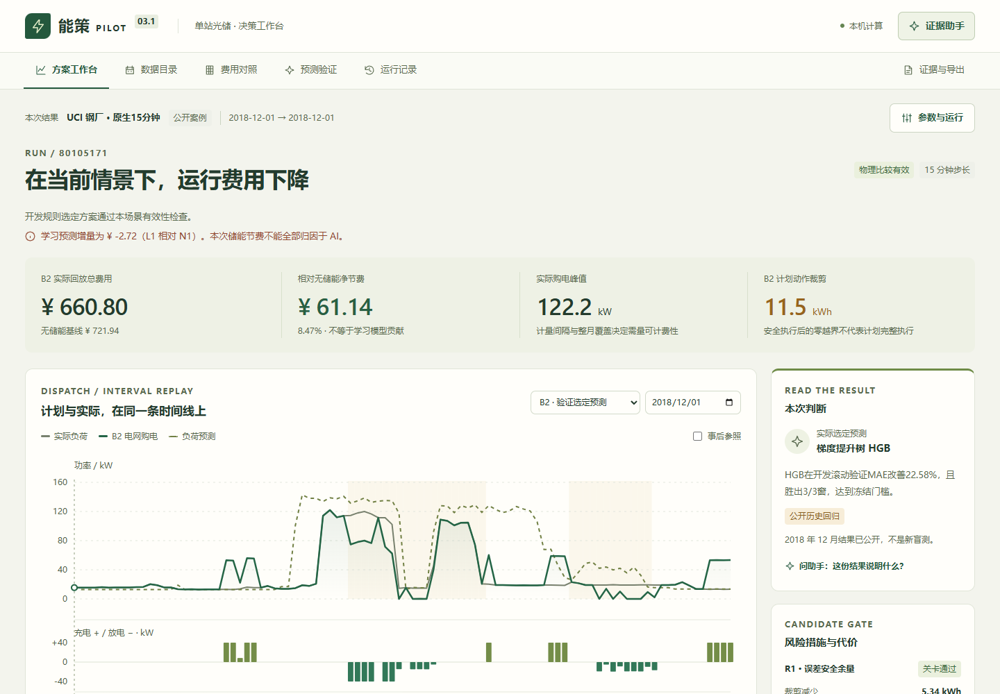

# 能策 Pilot · 可复算的光储方案工作台

面向能源方案研究与影子验证的本地工作台：审查负荷来源，比较预测，求解受约束计划，回放实际动作，再把费用、风险与证据放回同一次运行。

[在线只读案例](https://yangwei251003.github.io/nengce-pilot/) · [公开数据附件](https://github.com/yangwei251003/nengce-pilot/releases/tag/v3.1.1-open) · [数据许可](data/DATA_LICENSES.md) · [本次验证](docs/open-source-validation.md)

> **本地完整版需要 Python 后端。GitHub Pages 只展示真实 CPU 预计算的公开案例，不执行优化、不接收文件、不调用模型。** 示例电价、电池与公开海外负荷构成研究场景，费用不是客户实际账单、已实现收益或投资回报。



## 能做什么

- **来源先行**：原生间隔、来源行、时区不确定性、缺测/插补标记、许可、原件与规范化数据哈希一并保留。
- **公平比较**：学习模型、日/周朴素、固定规则、滚动优化与风险候选共享物理约束；完美预知单列为不可部署的事后诊断。
- **计划与执行分开**：连续 SOC、充放电功率、禁止反送、终端目标、执行裁剪与求解失败有明确记录。
- **费用有边界**：分时购电、满足条件的完整月原生 15 分钟需量、另列的 AC 吞吐代理；小时数据不冒充 15 分钟需量。
- **一次运行，一套证据**：工作台、费用、预测、历史、JSON/CSV/HTML 导出绑定不可变结果；参数草稿不会覆盖旧结果。
- **本机证据解读**：默认是确定性查询与解释，不冒充语言模型。保留可选自有模型接口，调用前仍需用户显式配置和确认。

技术栈为 Python 3.12、FastAPI、Pydantic、NumPy/Pandas、SciPy、scikit-learn，以及 React 19、TypeScript、Vite。计算使用 CPU；没有设备控制接口或自动购买服务。

## 快速开始

实际验证环境：**Windows x64 / Python 3.12**。下载源码并解压，或克隆本仓库。首次准备需要网络安装锁定依赖、下载约 89 MB 的公开研究数据附件；不需要账号或模型密钥。

```powershell
py -3.12 setup.py --download-data
.\.venv\Scripts\python.exe start.py
```

打开 `http://127.0.0.1:8003`。预编译 React 界面及校验清单随源码保存在 `distribution/`，仅使用产品无需 Node.js。端口占用时可用 `start.py --port 8004`。关闭服务终端结束运行。

已手动下载数据包时：

```powershell
py -3.12 setup.py --archive .\public-research-data.zip
```

准备器验证压缩包及 84 个公开文件的 SHA256，遇既有不同内容拒绝覆盖。解压后的公开数据约 304 MB；数据附件是研究资产，不是依赖缓存。没有随包提供 wheel 缓存，也没有将缺少 wheel 的旧 `setup_offline.py` 作为安装入口。

默认 UCI 15 分钟案例可直接运行。**RSF 文献 PDF 未再分发**：其数据记录的 CC BY 4.0 不自动覆盖所链接文献。要恢复 RSF 原件校验，可自行取得官方文献，或显式运行：

```powershell
.\.venv\Scripts\python.exe tools/prepare_public_data.py --archive .\public-research-data.zip --fetch-rsf-reference
```

该命令从官方链接现取文献并核对冻结哈希，只保存本地。官方文件不可用或字节变化时会拒绝旧数据身份；缺文件的案例在目录中标明并禁止运行。其余已齐备公开原件的案例不受影响。

## 推荐体验路径

1. 数据目录审阅 UCI 的来源、原生 15 分钟与源时区未知的说明。
2. 参数页选择默认单日，实际运行；先观察原生 96 时段，再决定是否执行更长区间。
3. 在同一时间轴查看负荷、计划/实际充放电、购电与 SOC，定位裁剪。
4. 比较费用与预测，阅读不可比较、失败或候选门槛未通过的状态。
5. 从证据侧栏导出同一运行的 JSON、CSV 或 HTML；本机助手只解释已计算的事实。

修改前端需要 Node.js 24，在 `product/frontend` 执行 `npm ci`、`npm test`、`npm run build`。开发时先启动 Python，再执行 `npm run dev`；Vite 将 `/api` 代理到本机 8003。发布界面与源代码保持对应，许可证声明由构建后步骤一并复制。

## 公开数据与负结果

研究目录包含 32 个视图：UCI 同一钢厂的 15 分钟/小时视图、RSF 子负荷与同站 PV 假设连接、BDG2 固定 24 栋/6 个 site，以及 5 个只供审查的 OPSD 通道。视图数不等于独立站点数，OPSD 通道不参与调度或收益核算。

数据、来源语义和算法结论分开阅读。原冻结报告保留以下限制：

- BDG2 外部组学习预测相对开发选定的日朴素基线更差 8.37%，不包装为泛化成功。
- UCI 负荷增加 20% 的月回放出现 N1 不可行，整组公平比较失败；费用复算通过不能替代可执行性。
- R2 在该批公开回放中没有表现出优于 R1 的额外实证收益；RSF 风险改善未达到原设 10% 门槛。
- 原免费云助手完整 50 题门槛未通过，保留限流、校验失败和未完成；本次未调用真实云模型。
- UCI 午夜修正是工程推断，源行政时区未知；RSF 发布者已清洗/插补，子负荷配 PV 是研究假设；BDG2 小时轴不能恢复全部 DST 重复时刻。

摘要保留在 `qa/v3/`。原月回放完整 JSON 按原字节放在 [独立公开证据附件](https://github.com/yangwei251003/nengce-pilot/releases/download/v3.1.1-open/public-evaluation-evidence.zip)，校验清单为 `qa/v3/core-replay-suite/archive-manifest.json`。这些是原历史研究结果，本次没有重新跑完整外部组或月度实验，也没有改写其正式证据。

## 命令行与验证

```powershell
cd product
..\.venv\Scripts\python.exe -m backend.v3.cli --out outputs\public-day-001
..\.venv\Scripts\python.exe -m unittest discover -s tests -v
```

CLI 输出目录不能已有证据。完整 Python 回归需要全部公开数据原件及上述 RSF 本地参考文献；仅做默认 UCI 运行不需要补齐该 PDF。前端 33 项 DOM 测试不代替真实浏览器。

可选浏览器复验需要已有 Google Chrome 和 Python Playwright：

```powershell
.\.venv\Scripts\python.exe -m pip install playwright
.\.venv\Scripts\python.exe tools/verify_public_smoke.py
```

它使用全新隔离运行目录，仅提交公开 UCI 单日和本机证据查询，检查真实本地 API、导出哈希、本地界面及 Pages 子目录，结果保存在 `product/outputs/`，不调用云模型或硬件。

## 目录与归档范围

| 目录 | 内容 |
| --- | --- |
| `product/backend/` | 保留 V2 兼容模块，`v3/` 为主核心/API/运行库/助手 |
| `product/frontend/` | React 源码、依赖锁、测试与构建 |
| `distribution/` | 已校验的前端分发 ZIP，普通用户无需 Node |
| `data/archive-manifest.json` | 独立公开研究数据附件的完整原件清单与哈希 |
| `pages/` | 独立只读预计算案例与静态交互 |
| `qa/v3/` | 原公共评测摘要、选择冻结记录和公开测试夹具 |
| `licenses/` | 27 个 Python、3 个 JavaScript 运行依赖完整许可 |
| `docs/` | 协议、接口、历史版本说明与本次验证 |

原 V1/V2/V3/V3.1 属于同一项目版本链，建议使用一个仓库管理，详见 [版本盘点](docs/version-inventory.md)。本次核心快照不包含私人/客户 CSV、运行库、DPAPI 配置、凭据、财务预算/商业材料、证件、比赛规则截图、影片及其制作工程；这些原件继续本地保留，不能据此删除原工程。

## 许可与后续工作

自有源码、文档与整理工具采用 [MIT](LICENSE)。公开数据单独遵循 CC BY 4.0 或 BDG2 固定 v1.0 的原 MIT；第三方 Python/React 组件各保留原许可，见 [素材与软件许可](THIRD_PARTY.md)。根 MIT 不会替换数据、文献、商标或其他第三方权利。

后续继续补充公开场景、平台验证、预测负结果解释及专业语义审阅；硬件、真实合同、寿命与投资回报尚未验证。更新记录见 [CHANGELOG](CHANGELOG.md)。
